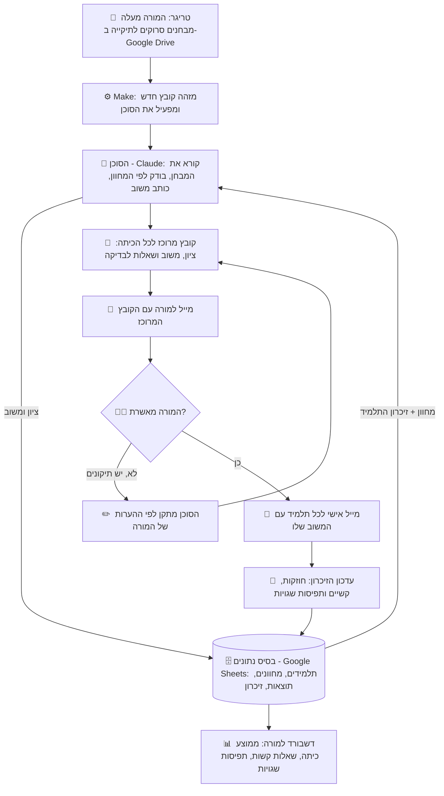
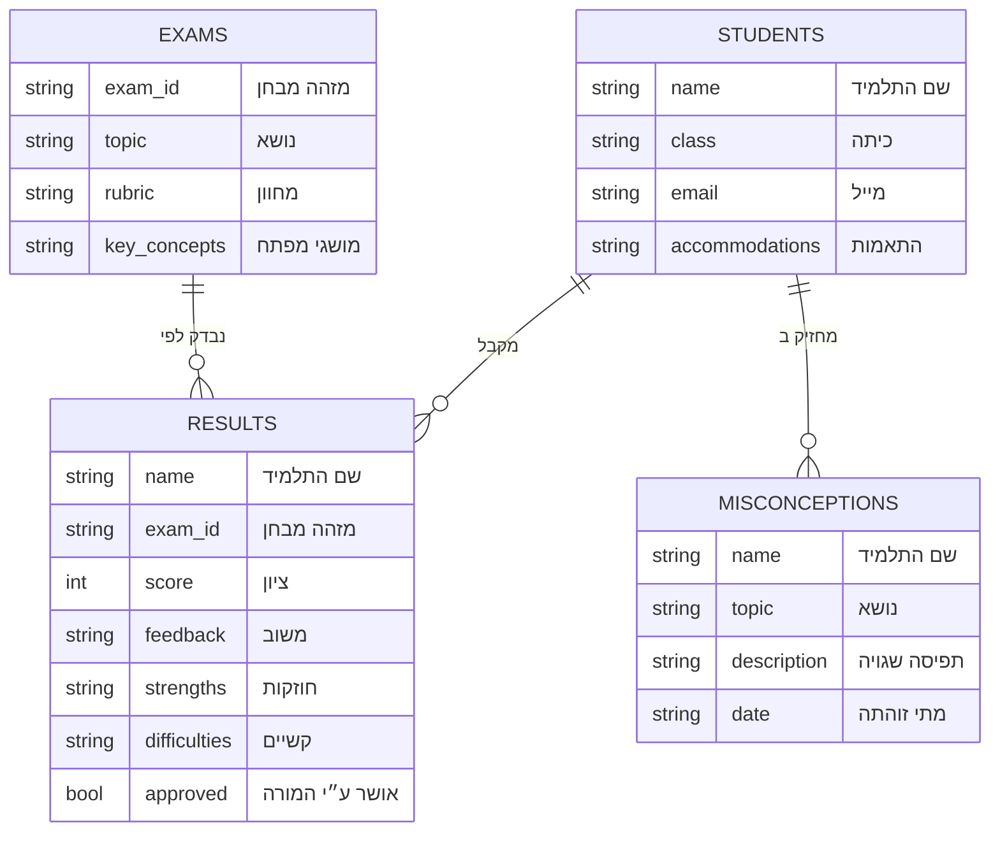
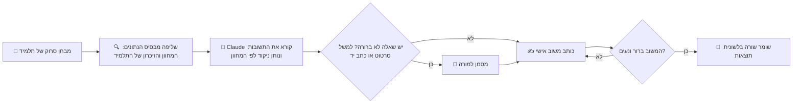
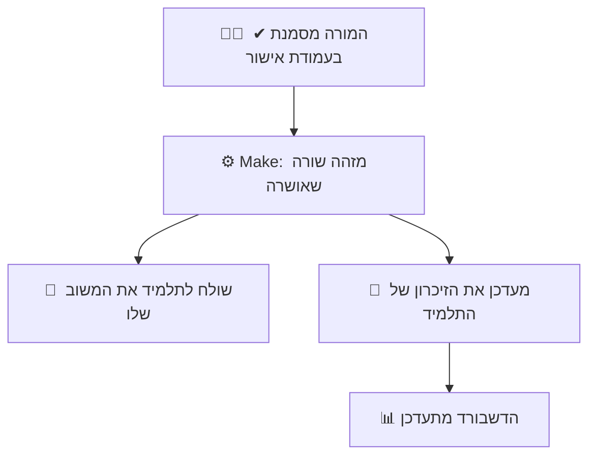

# ארכיטקטורת המערכת – בודק המבחנים במדעים

מסמך זה מתאר איך הסוכן מתוכנן לרוץ בפועל: מה מפעיל אותו, מאיפה מגיע המידע, איפה הוא נשמר ולאן הוא נשלח.
התכנון המלא של הסוכן עצמו נמצא בקובץ [SPEC.md](SPEC.md).

---

## 1. תמונה כללית

**הפלטפורמה:** Make, שמחברת בין האפליקציות בלי לכתוב קוד.
**המוח:** מודל השפה Claude של Anthropic, שמחובר ל-Make כמודול.

**העיקרון:** המורה עושה רק שני דברים. היא מעלה את המבחנים הסרוקים, ובסוף היא מאשרת את המשובים. את כל השאר עושה המערכת.

---

## 2. תרשים זרימה של כל המערכת

---

## 3. הטריגר: מה מפעיל את הסוכן

| מה | פירוט |
|---|---|
| **הטריגר** | קובץ חדש בתיקייה ב-Google Drive בשם `מבחנים לבדיקה / כיתה ה'2 / מערכת הנשימה` |
| **מי מפעיל** | המורה, כשהיא מעלה לתיקייה את המבחנים הסרוקים, קובץ PDF אחד לכל תלמיד |
| **איך Make יודע** | המודול Watch Files של Google Drive בודק את התיקייה כל 15 דקות |
| **מאיפה הסוכן יודע איזה מבחן זה** | שם התיקייה אומר מה הכיתה ומה הנושא. שם הקובץ הוא שם התלמיד, למשל `ישראל ישראלי.pdf` |

**למה דווקא תיקייה ב-Drive?** כי זה הכי קרוב לאיך שמורה עובדת היום: סורקת ושומרת. לא צריך ללמוד שום דבר חדש.

**טריגר שני:** המורה מסמנת ✔ בעמודת "אישור" בקובץ המרוכז. הסימון הזה מפעיל את שליחת המשובים לתלמידים (ראו סעיף 6).

---

## 4. בסיס הנתונים (Database)

בסיס הנתונים הוא קובץ Google Sheets אחד עם 4 לשוניות. זה הזיכרון הקבוע של הסוכן.

| לשונית | מה יש בה | מי ממלא |
|---|---|---|
| **תלמידים** | שם, כיתה, מייל, התאמות | המורה, פעם אחת בתחילת השנה |
| **מבחנים** | נושא, מחוון, מושגי מפתח, תפיסות שגויות נפוצות | המורה, לפני כל מבחן |
| **תוצאות** | ציון, משוב, חוזקות, קשיים, אישור | הסוכן, והמורה מסמנת אישור |
| **תפיסות שגויות** | איזה תלמיד, איזה רעיון שגוי, ומתי | הסוכן |

---

## 5. מה קורה בתוך הסוכן (לכל מבחן)

---

## 6. הפלט: מה עושים עם התוצאות

| פלט | למי | מתי | איך |
|---|---|---|---|
| **קובץ מרוכז** | המורה | אחרי שכל המבחנים בתיקייה נבדקו | מייל עם קישור ל-Google Sheet |
| **משוב אישי** | כל תלמיד | **רק** אחרי שהמורה סימנה ✔ באישור | מייל אישי |
| **זיכרון מעודכן** | בסיס הנתונים | אחרי האישור | שורות חדשות בלשוניות תוצאות ותפיסות שגויות |
| **דשבורד** | המורה | מתעדכן לבד כל הזמן | Looker Studio, שמחובר ל-Google Sheets |

---

## 7. הדשבורד למורה

מסך אחד שמראה את מצב הכיתה במבט מהיר. הוא בנוי ב-Looker Studio, כלי חינמי של Google שמתחבר ישירות ל-Google Sheets.

| רכיב בדשבורד | מה הוא מראה | למה זה עוזר למורה |
|---|---|---|
| **ממוצע כיתה** | מספר אחד גדול, והשוואה למבחן הקודם | לראות מגמה |
| **השאלות הקשות** | גרף עמודות: כמה תלמידים טעו בכל שאלה | לדעת על מה לחזור בשיעור |
| **תפיסות שגויות נפוצות** | רשימה, למשל "הסרעפת זזה בגלל האוויר: 9 תלמידים" | לתכנן ניסוי או הדגמה |
| **תלמידים לתשומת לב** | מי ירד ביותר מ-10 נקודות | לזהות מוקדם מי צריך עזרה |
| **ממתינים לאישור** | כמה משובים עוד לא אושרו | לא לשכוח לשלוח |

---

## 8. תרחישי Make

המערכת בנויה משני תרחישים (Scenarios) נפרדים ב-Make:

**תרחיש 1: בדיקת מבחנים**
1. Google Drive – Watch Files: קובץ חדש בתיקייה
2. Google Sheets – Search Rows: שליפת התלמיד והמחוון
3. Anthropic Claude – Create a Message: בדיקה וכתיבת משוב
4. Google Sheets – Add a Row: שמירה בלשונית תוצאות
5. Gmail – Send an Email: שליחת קישור לקובץ המרוכז למורה

**תרחיש 2: שליחה אחרי אישור**
1. Google Sheets – Watch Rows: שורה שבה עמודת האישור סומנה ✔
2. Gmail – Send an Email: משוב לתלמיד
3. Google Sheets – Add a Row: עדכון הלשונית תפיסות שגויות

---

## 9. פרטיות ואבטחה

- **הכול נשאר בחשבון Google של בית הספר.** התיקייה, בסיס הנתונים והדשבורד משותפים רק עם המורה.
- **לא נשלח שום דבר לתלמיד בלי אישור המורה.**
- **כל תלמיד מקבל רק את המשוב שלו.** הוא לא רואה ציונים של אחרים.
- **בסוף השנה מוחקים** את לשוניות התוצאות והתפיסות השגויות.
- **ל-Claude נשלח רק מה שצריך:** המבחן, המחוון והזיכרון של אותו תלמיד, בלי מידע אישי אחר.
